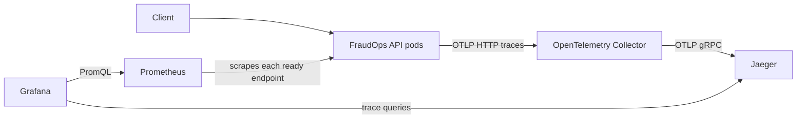

# FraudOps Fraud Scoring API

EXP-001 exposes the existing EXP-000 ONNX fraud model as a Java REST service. The model and preprocessing are not modified or duplicated in Java.

## Experiment Index and Repository Layout

Run documented commands from the repository root. Reports retain the results and limitations recorded for their original experiment; later experiments do not retroactively change those results.

| Experiment | Report | Retained evidence |
| --- | --- | --- |
| EXP-000 — Python model and ONNX export | [Report](experiments/EXP-000/report.md) | [Original metrics](experiments/EXP-000/evidence/metrics.json) |
| EXP-001 — Java inference API | [Report](experiments/EXP-001/report.md) | Results recorded in report; parity fixtures stay under `src/test/resources/` |
| EXP-002 — Docker image | [Report](experiments/EXP-002/report.md) | Results and original runtime limitations recorded in report |
| EXP-003 — Kubernetes deployment/scaling | [Report](experiments/EXP-003/report.md) | [Evidence](experiments/EXP-003/evidence/) |
| EXP-004 — Observability | [Report](experiments/EXP-004/report.md) | [Evidence](experiments/EXP-004/evidence/) |

No separate EXP-002B report exists in this checkout; no report or evidence was invented for it. Repository organization does not start another experiment.

Curated reports and reproducibility evidence belong in `experiments/EXP-XXX/`. New runs, image archives, build logs, temporary transport logs, and isolated kubeconfigs belong in ignored root `artifacts/EXP-XXX/`. The Kubernetes kubeconfig is now `artifacts/EXP-003/kubeconfig`; the helpers still pass it and context `kind-fraudops-exp003` explicitly, without changing the default context. Raw captures retain historical command strings verbatim, including the paths used when they were recorded.

The accepted ONNX model, metadata, Dockerfile, Maven project, application source, test fixtures, and Kubernetes manifests retain their existing locations. The accepted CSV stays at `data/synthetic_transactions.csv` because the metadata references it. New training outputs default to `artifacts/EXP-000/`, and `--output-dir` can select a separate reproduction directory. Promote only reviewed, non-sensitive evidence from a completed run; leave credentials, transport logs, and large temporary archives in `artifacts/`.

See the [migration summary](experiments/MIGRATION.md) for path mappings and validation results.

## Requirements and Versions

- Java 21
- Maven 3.9+
- Spring Boot 3.5.8
- ONNX Runtime Java 1.23.2
- JUnit 5 via the Spring Boot 3.5.8 dependency BOM

The ONNX model uses opset 17. Maven resolves the remaining Spring, Jackson, and test dependency versions through the Spring Boot BOM in `pom.xml`.

## Build and Run

Run commands from the repository root. The service loads `./fraud_model.onnx` and `./model_metadata.json` by default.

```powershell
mvn clean test
mvn package
java -jar target/fraud-scoring-api-1.0.0-exp001.jar
```

For development, `mvn spring-boot:run` starts the application on port 8080. A successful model load is required for application startup and readiness.

## Configuration

| Environment variable | Default | Purpose |
| --- | --- | --- |
| `SERVER_PORT` | `8080` | HTTP port |
| `FRAUD_MODEL_PATH` | `./fraud_model.onnx` | ONNX model path |
| `FRAUD_MODEL_METADATA_PATH` | `./model_metadata.json` | Model metadata path |
| `FRAUD_REVIEW_THRESHOLD` | `0.06729906797409058` | Review when probability is greater than or equal to this value; must be finite and between 0 and 1 |
| `FRAUD_TRACE_EXPORT_ENABLED` | `false` | Enable OTLP trace export; enabled by the EXP-004 Kubernetes overlay |
| `FRAUD_OTLP_ENDPOINT` | `http://localhost:4318/v1/traces` | OTLP HTTP endpoint; EXP-004 uses the local Collector Service |
| `FRAUD_TRACE_SAMPLE_PROBABILITY` | `0.1` | Trace sampling probability; EXP-004 sets 1.0 for its short local demonstration |
| `FRAUD_IMAGE_REVISION` | `exp004` | Runtime log revision marker; separate from the unchanged model version |

## Prediction API

`POST /api/v1/predict` accepts the nine EXP-000 named features. All fields are JSON numbers or `null`. A missing or `null` feature becomes IEEE `NaN` in its tensor, allowing the ONNX pipeline to apply its embedded imputation. Invalid types, infinities, negative nonnegative-domain values, fractional integer features, and invalid binary values return structured HTTP 400 errors. Unknown integer category codes are accepted and handled by the exported one-hot encoder as all-zero for that category.

```json
{
  "amount": 250.0,
  "account_age_days": 120,
  "transactions_last_24h": 5,
  "distance_from_home_km": 150.0,
  "device_age_days": 30,
  "country_mismatch": 1,
  "card_present": 0,
  "channel_code": 0,
  "merchant_category_code": 2
}
```

Example PowerShell request:

```powershell
$body = @{
  amount = 250.0
  account_age_days = 120
  transactions_last_24h = 5
  distance_from_home_km = 150.0
  device_age_days = 30
  country_mismatch = 1
  card_present = 0
  channel_code = 0
  merchant_category_code = 2
} | ConvertTo-Json
Invoke-RestMethod -Method Post -Uri http://localhost:8080/api/v1/predict `
  -ContentType 'application/json' -Body $body
```

The response contains `fraud_probability`, `model_version`, and a separate policy decision (`review` or `approve`). There is no automatic decline decision. Numeric features are amount in USD, ages in days, transaction count, and distance in kilometers. Binary features are `0` or `1`. `channel_code` values are 0 ecommerce, 1 in-store, and 2 mobile. `merchant_category_code` values are 0 grocery, 1 fuel, 2 electronics, 3 travel, and 4 digital goods. See [model_metadata.json](model_metadata.json) for the complete schema.

## Health

- `/actuator/health` reports application and model health.
- `/actuator/health/liveness` reports process liveness without running inference.
- `/actuator/health/readiness` includes model initialization status.
- `/actuator/metrics` exposes local Spring/Micrometer metrics, including JVM heap usage, for the experiment's load baseline.
- `/actuator/prometheus` exposes histogram-based HTTP/ONNX timing, inference/decision counters, and JVM/process metrics for EXP-004.

## Tests and Parity

```powershell
mvn test
python generate_parity_fixtures.py
mvn test
```

The parity fixture generator uses Python ONNX Runtime and the unchanged EXP-000 `fraud_model.onnx`; it does not retrain the model. Java tests compare five representative inputs against these references with absolute tolerance `1e-5` and relative tolerance `1e-4`. The test suite also covers mapping, missing values, threshold behavior, malformed input, artifact startup failures, health endpoints, and concurrent requests.

## Local Load Baseline

With the application running, use the repeatable standard-library load driver:

```powershell
python scripts/load_test.py --requests 2000 --concurrency 16 --warmup-requests 200
```

The output includes throughput, p50/p95/p99 end-to-end HTTP latency, error count/rate, and JVM heap used from Actuator. It performs 200 warmup requests by default. Results depend on host load and client/server placement; they are not directly comparable to EXP-000's in-process Python ONNX `session.run` latency.

## Docker (EXP-002)

Docker Engine with BuildKit enabled is required. Build from the repository root; `.dockerignore` excludes the generated dataset, Maven `target`, IDE files, Python caches/environments, and local secret files while retaining the model, metadata, Java source, tests, and health-check source.

```powershell
docker build -t fraudops-api:exp002 --build-arg APP_VERSION=1.0.0-exp001 --build-arg MODEL_VERSION=1.0.0-exp000 .
docker run --rm --name fraudops-api -p 8080:8080 --cpus=2 --memory=1g fraudops-api:exp002
```

The two image bases are pinned by version and immutable Docker Hub manifest digest: `maven:3.9.11-eclipse-temurin-21-noble` and `eclipse-temurin:21.0.8_9-jre-noble`. The build stage runs `mvn clean verify`, including tests and parity, with a BuildKit Maven cache. The runtime stage contains only the executable jar, the unchanged model and metadata, and a tiny Java readiness probe. It runs as UID/GID 10001; the application artifacts are root-owned and read-only. The app image version and model version are separate image labels.

The readiness probe is compiled during the build and executed by Java in the JRE image, so container health does not assume that a shell, curl, or wget exists. Check with `docker inspect --format '{{.State.Health.Status}}' fraudops-api` or query `http://localhost:8080/actuator/health/readiness`. Docker's health status is a container-level health signal; it does not itself restart an unhealthy container. Kubernetes liveness/readiness probes should target the separate Actuator liveness and readiness endpoints.

Configuration continues to use `SERVER_PORT`, `FRAUD_MODEL_PATH`, `FRAUD_MODEL_METADATA_PATH`, and `FRAUD_REVIEW_THRESHOLD`. `JAVA_TOOL_OPTIONS` defaults to container-aware sizing with `-XX:InitialRAMPercentage=20.0 -XX:MaxRAMPercentage=60.0`, leaving memory outside the Java heap for ONNX Runtime native allocations and the rest of the process. Override it when testing a specific limit, while reserving native headroom.

Initial resource-limit trials:

```powershell
docker run --rm --name fraudops-api --cpus=2 --memory=1g -p 8080:8080 fraudops-api:exp002
docker run --rm --name fraudops-api --cpus=1 --memory=512m -p 8080:8080 fraudops-api:exp002
docker run --rm --name fraudops-api --cpus=0.5 --memory=256m -p 8080:8080 fraudops-api:exp002
```

For each running case, run `python scripts/load_test.py --requests 2000 --concurrency 16 --warmup-requests 200`; capture `docker stats --no-stream`, `docker inspect` restart/OOM/health state, and `/actuator/metrics/jvm.memory.used?tag=area:heap`. The 256 MiB case is deliberately a stress trial; heap percentage limits are not a guarantee that native allocations will fit. Do not raise limits silently if startup or inference fails.

Spring uses graceful server shutdown with a 25-second shutdown phase. The Docker image is exec-form with Java as PID 1 and `STOPSIGNAL SIGTERM`; use `docker stop --time 35 fraudops-api` to allow the Spring phase plus a 10-second margin. To verify in-flight completion, generate concurrent traffic while stopping the container and check completed responses, logs, exit status, and resource cleanup. The Docker health state and shutdown behavior have not been runtime-verified on this workstation because Docker Engine is unavailable.

Image tagging convention: `fraudops-api:<experiment-or-release-tag>`, with app/model versions retained separately as OCI labels. No credentials are embedded in the image.

## Kubernetes (EXP-003)

EXP-003 deploys the existing image to a single-node local kind cluster, scales to three replicas, deletes a pod, and rolls out a new image with baked-in Spring logging/application-name configuration. Java inference code, the jar, model, metadata, and prediction contract remain unchanged. See [the experiment report](experiments/EXP-003/report.md) for actual results, timing methodology, failures, and limitations.

Prerequisites: Docker Engine running with enough memory for kind and up to four API containers during rollout, kind, kubectl, Bash, and Python 3.9+. The measured host gave Docker approximately 8 GiB. Host Java/Maven are optional: image builds run Java 21 tests in Docker. Initial node/compiler/base-image downloads need internet; application images are loaded locally without a registry.

Run from the repository root:

```bash
# Dedicated fraudops-exp003 cluster; kubeconfig stays in ignored artifacts/.
bash scripts/exp003.sh create
# Uses fraudops-api:exp002 locally, or builds it if absent. Builds the new
# runtime-visible revision and a small Java test client; loads all into kind.
bash scripts/exp003.sh images
bash scripts/exp003.sh deploy
bash scripts/exp003.sh status

# Runs fixture parity, scales 1 -> 3, measures deletion/replacement, and
# rolls exp002 -> exp003-r1 while sending requests without retries.
# Creates a new timestamped evidence directory and stops its port-forwards.
bash scripts/exp003.sh verify
```

For interactive local access in another terminal:

```bash
export KUBECONFIG="$PWD/artifacts/EXP-003/kubeconfig"
kubectl --context kind-fraudops-exp003 -n fraudops-exp003 \
  port-forward service/fraudops-api 8080:8080
# Use the prediction request above against http://localhost:8080.
```

The ClusterIP Service exposes port 8080. Port-forwarding a Service chooses one pod and bypasses ClusterIP traffic selection; it does not demonstrate balancing and can stop when that pod is deleted. The verifier instead also forwards to a separate test-client pod on local port 18081. That client sends fresh connections to `fraudops-api:8080` inside Kubernetes. Unique request IDs in per-pod Tomcat access logs demonstrate actual routing across ready endpoints. Local port 18080 verifies direct Service-selected-pod access. These ports must be free; invoke `python3 scripts/exp003_verify.py --help` for overrides.

Manifests live in [k8s/](k8s/). `kubectl apply -k k8s/` includes only the namespace, ConfigMap, Deployment, and Service. Each API pod requests 250m CPU / 256Mi memory and is limited to 1 CPU / 512Mi. The container runs as UID/GID 10001 with a read-only root filesystem and a bounded ephemeral `/tmp` mount for native-library extraction, Tomcat, and access logs. Probes use the existing liveness/readiness endpoints. Rolling updates allow one additional pod and zero unavailable pods; termination reserves 5 seconds for endpoint propagation, 25 seconds for Spring shutdown, and 5 seconds of margin.

To repeat the experiment, restore the one-replica base deployment with `bash scripts/exp003.sh deploy` before `verify`; keep image tags fixed during each run. Evidence includes per-request results, pod/EndpointSlice timelines, rollout status, final resources/restart state, and revision-marker application logs. Metrics Server is optional and is not installed by this experiment.

Cleanup after stopping any manual port-forward with Ctrl-C:

```bash
bash scripts/exp003.sh cleanup
```

This deletes only the named experiment cluster. Local images and generated evidence are retained. The helper passes an explicit kubeconfig and context, leaving the default user kubeconfig untouched.

## Observability (EXP-004)

EXP-004 adds Micrometer's Prometheus registry, Spring Boot's Micrometer/OpenTelemetry bridge, an explicit `onnx.inference` child span, and logs with `trace_id`/`span_id`. The ONNX implementation, exported model, parity fixtures, and decision threshold are unchanged. See [the experiment report](experiments/EXP-004/report.md) for measurements, trace evidence, alert firing states, and limitations.



Use the existing EXP-003 cluster and client pod. For a new environment, first run `bash scripts/exp003.sh create`, `images`, and `deploy` as described above. Then:

```bash
bash scripts/exp004.sh build    # Existing tests plus observability integration test
bash scripts/exp004.sh images   # Explicit versions; load host-platform archives into kind
bash scripts/exp004.sh deploy   # Stack, then three instrumented API replicas
bash scripts/exp004.sh verify  # Workloads, trace checks, deletion, real rollout, two alerts
bash scripts/exp004.sh status
```

The verifier requires free local ports 18080, 18081, 18082, 19090, 13000, and 16686. It stops its port-forwards when finished and writes timestamped machine-readable evidence under ignored `artifacts/EXP-004/`. It leaves three ready `exp004-r1` API pods and the stack running. Run `deploy` before repeating `verify` to restore the base EXP-004 image.

Open the interfaces through separate terminal sessions (port-forwards bind loopback only):

```bash
export KUBECONFIG="$PWD/artifacts/EXP-003/kubeconfig"
kubectl --context kind-fraudops-exp003 -n fraudops-exp003 port-forward --address=127.0.0.1 service/grafana 13000:3000
kubectl --context kind-fraudops-exp003 -n fraudops-exp003 port-forward --address=127.0.0.1 service/prometheus 19090:9090
kubectl --context kind-fraudops-exp003 -n fraudops-exp003 port-forward --address=127.0.0.1 service/jaeger 16686:16686
```

- Grafana: `http://127.0.0.1:13000/d/fraudops-api-overview` — **FraudOps API Overview**, anonymous local Viewer access. Data sources and 12 panels are provisioned from files.
- Prometheus: `http://127.0.0.1:19090` — inspect targets, query metrics, and view alerts.
- Jaeger: `http://127.0.0.1:16686` — query service `fraudops-api`; successful prediction traces contain an HTTP server span and its ONNX child.

Configuration is under [k8s/observability/](k8s/observability/). EndpointSlice discovery scrapes every ready API endpoint and tracks new pods after replacement/rollout. Dashboard percentiles aggregate histogram bucket rates across pods before `histogram_quantile`; they do not average pod percentiles. Empty series remain missing data. The availability panels show successful scrapes of ready endpoints, not the Deployment's desired replica count. Shared EXP-003 resources now live in `k8s/base/`; the `kubectl apply -k k8s/` entry point is preserved.

Alert thresholds are deliberately short demonstration settings: 5xx ratio above 20%, and HTTP p95 above 100ms, each sustained for 10s over a 30s query window. Verification temporarily creates a separate opt-in demo Job, with a 180s deadline and a 160-request endpoint budget, then deletes it. Its controlled 500s and 300ms delays exercise the same HTTP metrics and inference-error counter. It is excluded from the prediction Service and main dashboard panels. Both alert rules apply per application label; the verifier checks firing and resolution through the Prometheus API. No Alertmanager or external notifications are configured.

All components use local ClusterIP Services, with no public ingress or external credentials. Prometheus keeps at most two hours / approximately 512MB of local time series; Jaeger keeps at most 10,000 traces in memory. Data is ephemeral and disappears when those pods are replaced. No Metrics Server is installed; the verifier records available JVM/process metrics and container cgroup snapshots instead.

Stop manual port-forwards before cleanup:

```bash
bash scripts/exp004.sh cleanup  # Restore one EXP-003 API pod and remove the stack
# Or delete the entire dedicated learning cluster:
bash scripts/exp003.sh cleanup
```

## Known Limitations

The EXP-000 classifier was trained on synthetic data and has modest held-out fraud recall. The API is an integration experiment, not a production fraud-control recommendation. Input ranges are basic semantic checks, not a business-approved schema; unknown category codes are intentionally accepted per the exported pipeline behavior. Local performance measurements are not deployment capacity guarantees. Historical runtime gaps and subsequent Kubernetes/observability measurements are distinguished in the experiment reports. The single-node kind experiment does not establish production availability or capacity. The inference API has no authentication or database; observability interfaces are for local development only.
